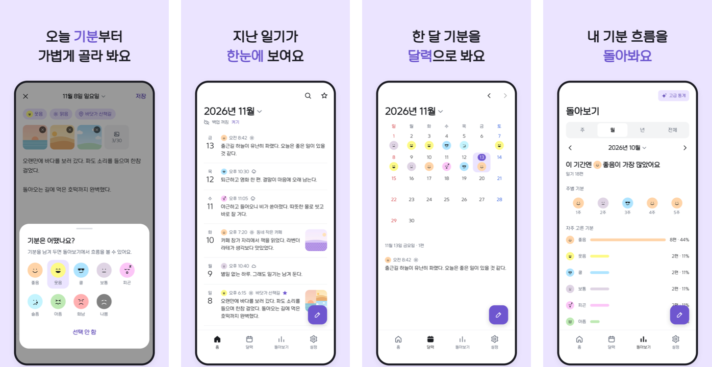

<!-- 원문: diary-project 저장소 README와 docs/store/listing.md. 기능·가격이 바뀌면 함께 고친다. -->

바쁜 사람을 위한 간편한 일기장이에요. 기분을 고르고 몇 줄만 남기면 오늘 일기가 끝나요.

회원 가입이 없어요. 일기는 휴대폰에 저장되고, 원하면 사진까지 내 구글 드라이브에 백업할 수 있어요.

[Google Play에서 받기](https://play.google.com/store/apps/details?id=org.sjhstudio.diary)

## 할 수 있는 것

| 기능 | 내용 |
| --- | --- |
| 쓰기 | 글, 사진, 기분, 날씨, 장소를 한 편에 담아요. 굵게, 밑줄, 글자색, 형광펜, 목록을 쓸 수 있어요. |
| 다시 보기 | 목록, 캘린더, 검색, 즐겨찾기로 지난 일기를 찾아요. |
| 기분 통계 | 주, 월, 연 단위로 어떤 기분이 많았는지 봐요. |
| 백업과 복원 | 사진까지 구글 드라이브에 백업할 수 있어요. 복원하면 지금 일기와 합쳐져요. |
| 잠금과 휴지통 | 비밀번호나 생체 인증으로 잠가요. 삭제한 일기는 휴지통에 30일 동안 남아요. |

## 구글 드라이브 권한

구글 로그인은 백업 파일을 사용자 본인의 구글 드라이브에 두는 데만 써요. 앱이 만든 백업 파일만 읽고 쓰며, 드라이브의 다른 파일은 보지 않아요. 일기와 사진은 개발자 서버로 보내지 않아요.

## 약관과 개인정보

- [개인정보처리방침](/1day1diary/privacy/)
- [이용약관](/1day1diary/terms/)
- 문의: sjunh812@naver.com

---

### English

1 Day 1 Diary is a simple diary for busy days. Pick a mood, write a few lines, and today's entry is done.
There is no sign-up. Entries stay on your phone, and you can back them up, photos included, to your own Google Drive.
Google sign-in is used only to store backup files in your own Google Drive. The app reads and writes only the backup files it creates.

[Privacy Policy](/1day1diary/privacy/) · [Terms of Service](/1day1diary/terms/) · Contact: sjunh812@naver.com
