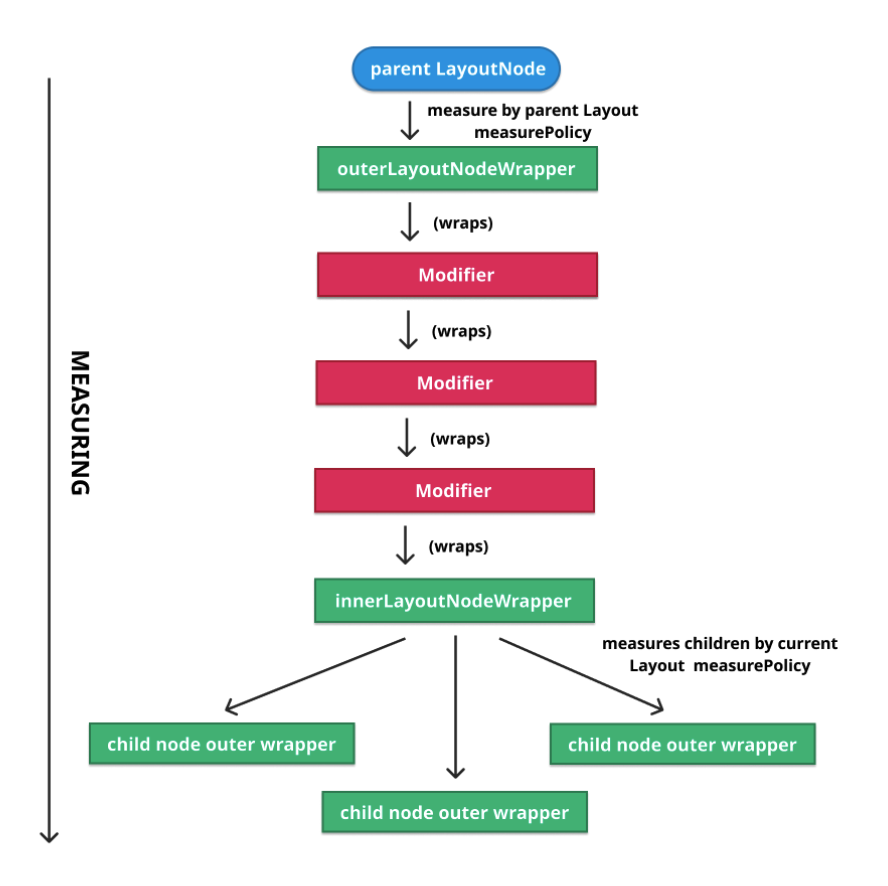

> Compose Internals 책을 읽고 발표한 내용을 정리한 글이다.  
> 앞선 내용들은 책을 이미 읽었다는 가정하에 설명한다.  

## **재측정의 시작**
노드에서 자식이 연결되거나 분리되거나 이동되는 등의 변화가 생기면,  
어떤 `LayoutNode`라도 Owner를 통해 재측정을 요청할 수 있다.  
그 시점에 뷰(Owner)는 **"dirty"로 표시(invalidate)** 되고, 해당 노드는 **재측정 및 재배치할 노드 목록**에 추가된다.

여기서 중요한 점은 이 작업이 **즉시 실행되지 않는다는 것**이다.  
한 프레임 안에서는 상태 변경, 자식 추가/제거, modifier 변경 등으로 인해 여러 invalidation이 한꺼번에 몰릴 수 있다.  
만약 요청이 들어올 때마다 곧바로 측정을 수행한다면 같은 노드를 한 프레임에 여러 번 측정하는 낭비가 발생한다.  
그래서 Compose는 변경을 예약해두었다가 그리기 직전에 한 번에 처리한다.  

실제로 다음 그리기 시점에 `AndroidComposeView#dispatchDraw`가 호출되고,  
`AndroidComposeView`는 예약된 노드 목록을 순회하며 **delegate**를 통해 실제 측정·배치 작업을 수행한다.

## **Delegate**
이 "예약과 일괄 처리"를 담당하는 것이 `MeasureAndLayoutDelegate`다.  
```kotlin
/**
 * Keeps track of [LayoutNode]s which needs to be remeasured or relaid out.
 *
 * Use [requestRemeasure] to schedule remeasuring or [requestRelayout] to schedule relayout.
 *
 * Use [measureAndLayout] to perform scheduled actions and [dispatchOnPositionedCallbacks] to
 * dispatch [OnGloballyPositionedModifier] callbacks for the nodes affected by the previous
 * [measureAndLayout] execution.
 */
internal class MeasureAndLayoutDelegate(private val root: LayoutNode) {
    ...
    /**
     * Requests remeasure for this [layoutNode] and nodes affected by its measure result.
     *
     * @return true if the [measureAndLayout] execution should be scheduled as a result of the
     *   request.
     */
    fun requestRemeasure(layoutNode: LayoutNode, forced: Boolean = false): Boolean =
        when (layoutNode.layoutState) {
            Measuring,
            LookaheadMeasuring -> {
                // ..
            }
            LookaheadLayingOut,
            LayingOut -> {
                // ...
            }
            Idle -> {
                // ...
            }
        }
    ...

    /**
     * Requests relayout for this [layoutNode] and nodes affected by its position.
     *
     * @return true if the [measureAndLayout] execution should be scheduled as a result of the
     *   request.
     */
    fun requestRelayout(layoutNode: LayoutNode, forced: Boolean = false): Boolean =
        when (layoutNode.layoutState) {
            Measuring,
            LookaheadMeasuring,
            LookaheadLayingOut,
            LayingOut -> {
                // ...
            }
            Idle -> {
                // ...
            }
        }

    /**
     * Iterates through all LayoutNodes that have requested layout and measures and lays them out
     */
    fun measureAndLayout(onLayout: (() -> Unit)? = null): Boolean {
        var rootNodeResized = false
        performMeasureAndLayout(fullPass = true) {
            if (relayoutNodes.isNotEmpty()) {
                relayoutNodes.popEach { layoutNode, affectsLookahead, relayoutNeeded ->
                    val sizeChanged =
                        if (relayoutNeeded) {
                            remeasureAndRelayoutIfNeeded(layoutNode, affectsLookahead)
                        } else {
                            val sizeChanged =
                                remeasureIfNeeded(
                                    layoutNode,
                                    affectsLookahead,
                                    shouldTraceMeasure = true,
                                )
                            // If relayout is deferred, it means we are invalidating measurements
                            // that could affect lookahead. We need to make sure any placement
                            // invalidation from measure/lookaheadMeasure of the layoutNode above is
                            // tracked and properly deferred.
                            if (layoutNode.lookaheadLayoutPending) {
                                relayoutNodes.add(layoutNode, Invalidation.LookaheadPlacement)
                            }
                            if (layoutNode.layoutPending) {
                                relayoutNodes.add(layoutNode, Invalidation.Placement)
                            }
                            sizeChanged
                        }
                    if (layoutNode === root && sizeChanged) {
                        rootNodeResized = true
                    }
                }
                onLayout?.invoke()
            }
        }
        callOnLayoutCompletedListeners()
        return rootNodeResized
    }
}
```

`MeasureAndLayoutDelegate`의 역할을 정리하면 다음과 같다.

1. **변경된 `LayoutNode` 관리** : 어떤 노드가 재측정/재배치가 필요한지 추적한다.
2. **작업 예약** : 변경이 생겼을 때 바로 실행하지 않고 `requestRemeasure`, `requestRelayout`으로 예약한다.
3. **일괄 처리** : `measureAndLayout()`에서 예약된 작업을 한 번에 처리한다.
4. **콜백 호출** : 위치가 확정된 뒤 `OnGloballyPositionedModifier` 콜백을 호출한다.

재측정·재배치가 예정된 각 노드에 대해서는 다음 3단계가 순서대로 이뤄진다.

1. 노드가 재측정이 필요한지 확인하고, 해당하면 재측정을 수행한다.
2. 측정 후, 노드가 재배치가 필요한지 확인하고, 해당하면 재배치를 수행한다.
3. 마지막으로 모든 노드에 대해 연기된 측정 요청이 있는지 확인하고, 해당 노드들의 재측정을 예약한다.  
즉, 그 노드들을 다음 차례의 재측정·재배치 목록에 추가하여 1단계로 되돌린다.  
(측정이 진행되는 도중에 들어온 재측정 요청은 이렇게 다음 패스로 연기된다.)

노드의 크기가 측정 결과로 바뀌었고 그 노드에 부모가 있다면, 필요에 따라 부모에게 다시 재측정이나 재배치를 요청한다.  
변경이 위로 전파되는 것이다.

## **측정 위임**
각 노드를 측정할 때, 이 작업은 외부 `LayoutNodeWrapper`에 위임된다.  
`LayoutNode#insertAt`(새 노드를 삽입하기 위해 `UiApplier`가 호출하는 함수)을 보면,  
외부·내부 `LayoutNodeWrapper`와 관련된 할당을 확인할 수 있다.
```kotlin
internal fun insertAt(index: Int, instance: LayoutNode) {
    // ...
    instance.outerLayoutNodeWrapper.wrappedBy = innerLayoutNodeWrapper
    // ...
}
```

> `LayoutNodeWrapper`는 이후 `NodeCoordinator`로 이름이 바뀌었다.  
> 따라서 `outerLayoutNodeWrapper → outerCoordinator`, `innerLayoutNodeWrapper → innerCoordinator`로 대응된다.  
> 또한 이 Coordinator들은 `LayoutNode`가 내부적으로 보유한 NodeChain의 양 끝(head/tail)에 해당한다.
{: .prompt-warning} 

## **modifier wrapper**
노드에는 modifier가 적용될 수 있고, modifier는 측정에 영향을 줄 수 있으므로 노드를 측정할 때 이를 함께 고려해야 한다.  
예를 들어 `Modifier.padding`은 자식 노드들의 측정에 직접 영향을 끼친다.  
그뿐 아니라 modifier는 뒤에 연결된 다른 modifier의 크기에도 영향을 줄 수 있다.  

예를 들어 `Modifier.padding(8.dp).background(Color.Red)`는 패딩을 적용하고 남은 공간에만 색을 입힌다.  
이는 곧 **modifier의 측정된 크기를 어딘가에 보관**해야 한다는 뜻이다.  
그런데 `Modifier` 자체는 상태가 없으므로, 상태를 유지하려면 별도의 **래퍼**가 필요하다.  
이런 이유로 **`LayoutNode`는 내·외부 래퍼뿐 아니라 적용된 modifier 각각에 대한 래퍼도 가진다.**   
그리고 모든 래퍼(외부, modifier들, 내부)는 연쇄적으로 연결되어 항상 정해진 순서대로 적용된다.

> modifier의 래퍼에는 측정된 크기뿐 아니라, 측정에 영향을 받을 수 있는 다른 훅(hook)들도 들어 있다.  
> 예를 들어 `Modifier.drawBehind()` 같은 그리기 작업이나 `pointerInput()` 같은 터치 히트 테스팅이 여기에 해당한다.
{: .prompt-info}

> modifier 래퍼는 현재 **`Modifier.Node`** 체계로 바뀌었다.  
> 이제 각 modifier는 `Modifier.Node`로 표현되어 NodeChain이라는 연결 리스트로 관리된다.  
> 이 가운데 측정에 개입하는 `LayoutModifierNode`만이 별도의 **`LayoutModifierNodeCoordinator`**를 갖고,  
> 나머지 노드(그리기·포인터 입력 등)는 Coordinator를 새로 만들지 않고 체인 위에 얹힌다.  
> 덕분에 modifier 변경 시 이전/이후 노드만 비교해 바뀐 부분만 갱신할 수 있어,  
> 과거보다 비교·재적용 비용이 크게 줄었다.
{: .prompt-warning} 

## **wrapper 간 연결**
모든 래퍼가 서로 연결된 방식은 다음과 같다.  
{: w="700" h="900" }    

1. 부모 `LayoutNode`는 자신의 `measurePolicy`를 사용하여 각 자식의 외부 래퍼를 측정한다.
2. 자식의 외부 래퍼는 체인의 첫 번째 modifier 래퍼로 측정을 넘긴다.
3. 이후 modifier 개수만큼 체이닝 형태로 계속 이어진다. (예시에서는 modifier 3개)
4. 체인의 끝에 있는 내부 래퍼는 현재 노드의 `measurePolicy`를 사용하여 그 노드의 자식들의 외부 래퍼를 측정한다. (다시 1단계로 이어진다.)

정리하면, **외부 래퍼는 "부모가 나를 어떻게 측정하는가"**를, **내부 래퍼는 "내가 내 자식을 어떻게 측정하는가"**를 담당한다.  
측정의 주체가 바뀌는 경계가 바로 이 두 래퍼다.

이 구조는 측정이 정해진 순서대로 이루어지고 modifier 또한 순서대로 처리되도록 보장한다.  
이때 측정 단계에 개입하는 modifier가 `LayoutModifier`다. (modifier에는 여러 유형이 있다.)  
그리기에서도 같은 방식으로 동작하는데, 다만 마지막 단계에서 내부 래퍼는 Z 인덱스로 정렬된 자식 목록을 순회하며 각각에 `draw`를 호출한다.  

앞서 본 `insertAt`의 래퍼 할당을 다시 보자.
```kotlin
instance.outerLayoutNodeWrapper.wrappedBy = innerLayoutNodeWrapper
```
노드가 삽입될 때, 그 노드의 외부 래퍼가 새로운 부모의 내부 래퍼에 의해 감싸지는 것을 볼 수 있다.  
즉 부모의 내부 래퍼가 자식의 외부 래퍼를 감싸면서 트리가 측정 체인으로 연결된다.

> **새 노드를 연결할 때 모든 LayoutNodeWrapper가 알림을 받는다.**    
> 래퍼들은 상태를 가지므로 생명주기를 가지며,  
> 초기화·해제가 필요한 경우를 대비해 연결·분리 이벤트를 모두 통지받는다.  
> 대표적인 예가 focus modifier로, 연결될 때 focus 이벤트를 전송한다.  
> 현재는 이 "연결·분리 시 알림" 메커니즘에 대해 `Modifier.Node`의 `onAttach()` / `onDetach()` 생명주기 콜백으로 이어진다.
> NodeChain이 modifier 리스트의 변경을 감지해 해당 콜백을 호출한다.
{: .prompt-info}

## **측정 람다와 상태 읽기**
노드에 재측정이 요청될 때마다, 그 작업은 노드의 외부 `LayoutNodeWrapper`에 위임된다.  
외부 래퍼는 측정 시 부모의 측정 정책을 사용하고, 이후 자신의 체인을 따라 모든 modifier를 재측정한 뒤,  
최종적으로 현재 노드의 측정 정책으로 자식을 재측정하는 내부 `LayoutNodeWrapper`에 도달한다.

노드를 측정하는 동안, 측정 람다(`MeasurePolicy`) 안에서 읽는 모든 **가변 상태(mutable state)** 읽기가 기록된다.   
이는 **읽은 상태가 바뀔 때마다 그 람다가 스스로 다시 실행되도록** 만든다.  
측정 정책은 외부에서 람다로 전달되기 때문에 Compose State에 자유롭게 의존할 수 있는 것이다.

> **핵심** : `MeasurePolicy`는 외부에서 주입되는 람다이므로 내부에서 state를 읽을 수 있고, 그 state가 측정의 의존성으로 자동 추적된다.

측정이 끝나면 이전에 측정된 크기와 새로 측정된 크기를 비교하여, 달라졌을 경우 부모에게 재측정을 요청한다.  
이렇게 변경이 위로 전파되면서 트리 전체의 일관성이 유지된다.